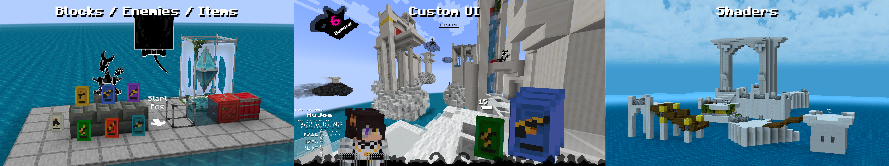
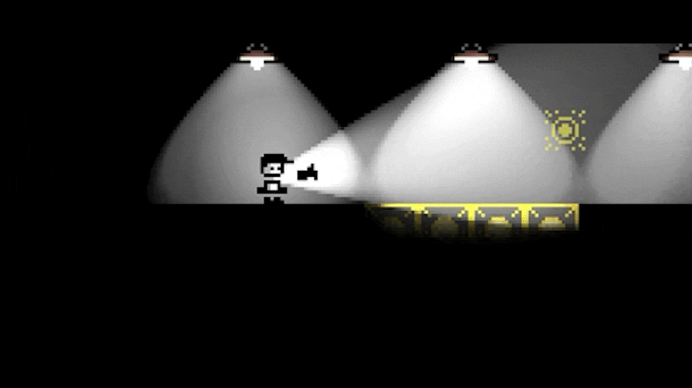

## Hi there 👋

I'm HuJoe, a solo freelance Minecraft Mod / Software Developer! I specialize in recreating popular (or niche) games into Minecraft Java Edition to make brand new experiences. I've also created a handful of Unity games by myself and with teams.

## Notable Projects

### Magical Soul Cards (Java)

I recreated the game **Neon White** in Minecraft 1.21.1. This was a 7-month project which included 6 unique movement cards (which also work as guns), modified physics, a fully custom UI, and a custom level saving and sharing system. It was a study in *3D movement/physics* where I attempted to recreate the bizarrely smooth movement created from many sources, like the movement cards, enemies, parrying, special blocks, etc.

You can find a video showcasing the mod and late development stages here: https://youtu.be/d-SO0VWysgo?si=CPutQDqHYh5sbG-5

### FlashPoint (GDScript)

**FlashPoint** is a puzzle platformer game I created in >2 weeks with a team of 5 others for Northeastern University's Game Dev Club 2026 *Jam-O-Lantern* game jam. In it, you have to traverse pitch black levels using your trusty flashlight. However, when you look away, things change in the darkness. Things can move, disappear, and become collidable/uncollidable. There's also many puzzle objects including overhead lights, doors, pushable boxes, and pressure plates.

You can see the itch.io page for it here: https://threethrow.itch.io/flashpoint

### HuJoe's Pills (Java)

### In Silence In Minecraft

<!--
**HuJoey/hujoey** is a ✨ _special_ ✨ repository because its `README.md` (this file) appears on your GitHub profile.

Here are some ideas to get you started:

- 🔭 I’m currently working on ...
- 🌱 I’m currently learning ...
- 👯 I’m looking to collaborate on ...
- 🤔 I’m looking for help with ...
- 💬 Ask me about ...
- 📫 How to reach me: ...
- 😄 Pronouns: ...
- ⚡ Fun fact: ...
-->
